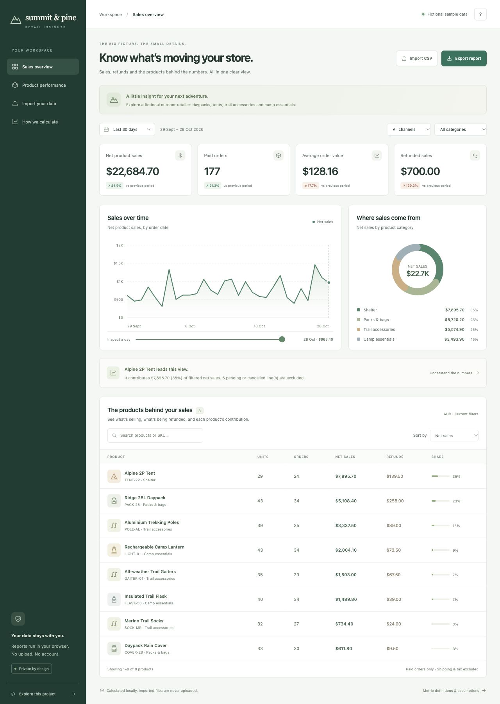
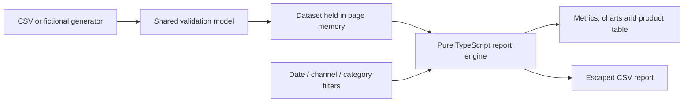

# Ecommerce Insights Dashboard

[](https://github.com/nnacrp0815/ecommerce-insights-dashboard/actions/workflows/ci.yml)

A retail reporting workspace that turns order-line CSVs into explainable sales metrics, trends and product reports. Built around **Summit & Pine**, a fictional outdoor retailer selling daypacks, tents, trekking poles, merino socks, flasks and camp accessories.

An original portfolio project with working CSV import/export, a shared TypeScript calculation engine, tests and a client-friendly portable demo. All sample orders and business results are synthetic. There is no employer source, customer data or live-store connection.

## Open the demo

Download [`demo.html`](demo.html) and open it in a browser. The single file includes its styles, scripts and deterministic sample-data generator. No installation, credentials, account, server or internet connection is needed to use the dashboard.

Try the date, channel and category filters; inspect daily sales with the keyboard-accessible slider; search or sort the product table; export a filtered CSV; then import your own correctly formatted order-line CSV. Reloading restores the fictional sample dataset.

<details>
<summary>Preview the dashboard</summary>



</details>

## What works

| Feature             | Behaviour                                                                                                  |
| ------------------- | ---------------------------------------------------------------------------------------------------------- |
| Sales summary       | Net product sales, distinct paid orders, average order value and refunded sales                            |
| Comparisons         | Previous period of equal length, with the same filters; unavailable comparisons are explicit               |
| Filtering           | Last 7/30/90 days, custom inclusive dates, sales channel and product category                              |
| Trends              | Daily net-sales chart with exact day inspection by keyboard or touch                                       |
| Category breakdown  | Sales contribution, category amounts and rounded shares                                                    |
| Product performance | Search, sort, units ordered, distinct product-order counts, net sales, refunds and share                   |
| CSV import          | Strict quoted CSV parsing, row validation, duplicate detection, exact decimal money and atomic replacement |
| CSV export          | Current product filters and period included; spreadsheet-formula prefixes escaped                          |
| Privacy             | Imported data stays in page memory; no upload endpoint, analytics, external fonts or browser storage       |
| Handover            | Documented data contract, metric definitions, tests, CI and reproducible demo                              |

## Develop and verify

Requires Node.js **24.14+ within 24.x** and npm.

```sh
git clone https://github.com/nnacrp0815/ecommerce-insights-dashboard.git
cd ecommerce-insights-dashboard
npm ci
npm run check
npm run demo
npm start
```

The local preview is [localhost:3100](http://127.0.0.1:3100). It binds to loopback and serves an explicit asset allowlist. Stop it with Ctrl+C. Set `PORT` to change its port. The server has no import or data-writing endpoint; CSV processing happens in the browser.

`npm run build` compiles the shared TypeScript modules, creates `public/core.js`, writes the fictional sample CSV and generates the portable `demo.html`. Commit generated artifacts with their source changes. `npm run check` checks formatting, compiles and runs the automated suite. `npm run demo` imports the sample CSV and verifies that daily, product and overall sales reconcile before exporting a report.

CI repeats checks and the command-line demo on Linux and macOS. There are no production npm dependencies; development tools are locked in `package-lock.json`. GitHub Actions are pinned to commit SHAs, with Dependabot configured for reviewable updates.

## CSV contract

Start with [`fixtures/summit-pine-orders.csv`](fixtures/summit-pine-orders.csv), also available through **Import CSV → Download sample CSV**. One row represents one order line. This is a deliberately documented reporting contract; an unmodified Shopify, WooCommerce or marketplace export needs a separately verified mapping.

| Required column       | Meaning                                                                                 |
| --------------------- | --------------------------------------------------------------------------------------- |
| `line_id`             | Unique line identifier across the complete file                                         |
| `order_id`            | Shared by all lines in an order                                                         |
| `date`                | Original order date, already expressed as the store's local calendar date: `YYYY-MM-DD` |
| `sku`                 | Product identifier; product name and category must be consistent for the same SKU       |
| `product`, `category` | Product and category labels                                                             |
| `channel`             | Sales channel label                                                                     |
| `status`              | `paid`, `pending` or `cancelled`                                                        |
| `quantity`            | Positive whole units ordered, maximum 10,000 per line                                   |
| `unit_price`          | Price of one unit before line discount, excluding shipping and tax                      |
| `discount`            | Total discount on this line, not a unit discount                                        |
| `refund`              | Total refunded product sales attributed to this line                                    |
| `currency`            | One three-letter uppercase currency code for the entire file                            |

Amounts are non-negative decimals with at most two decimal places, without symbols, separators or exponent notation. The model stores them as integer cents. The MVP accepts currencies with two decimal minor units; currencies such as JPY and BHD are rejected rather than silently rounded. It does not perform currency conversion.

The importer supports UTF-8 BOM, LF/CRLF, embedded quoted commas/newlines and doubled quotes. Headers are trimmed and case-normalized. Unrelated columns are ignored and never added to the data model. Empty required fields, duplicate IDs/headings, malformed rows, inconsistent order/SKU metadata, mixed currencies and impossible discounts/refunds reject the whole file. The existing report stays in place on a failed import.

Limits: 5 MiB of UTF-8 CSV, 50,000 lines, 100 categories, 50 channels and safe-integer monetary totals. A line discount cannot exceed gross sales; refunds cannot exceed sales after discounts. Pending/cancelled lines cannot carry refunds. Exported text fields that begin with spreadsheet-formula prefixes are escaped with an apostrophe.

## Metric definitions

For eligible **paid** lines in the inclusive date range and selected filters:

```text
gross product sales = sum(quantity × unit price)
net product sales = gross product sales − line discounts − refunded sales
paid orders = distinct order IDs among the matching paid lines
average order value = net product sales ÷ paid orders
refund share = refunded sales ÷ (gross product sales − line discounts)
```

Fully refunded paid orders remain in the order count. Under a category filter, order counts mean orders containing that category, and the average uses only matching line sales. Product-order counts overlap across products and should not be added together. Units are quantities ordered, not quantities retained after returns.

Refunds are assigned to the original order date, because the contract has no refund transaction date. Shipping, tax, processor/marketplace fees, product costs and cash settlement are excluded. This is an order-cohort product-sales report, not a profit, cash-flow or accounting statement.

The comparison period immediately precedes the selected range and has the same number of days. Percentage changes are unavailable when the earlier range falls outside the file's observed first/last dates or the relevant baseline is zero. No infinite uplift is displayed. Imported date coverage does **not** prove completeness: the application cannot detect omitted orders, and missing days within a window are treated as zero supplied sales.

## Architecture



`src/model.ts` validates the normalized data and money/date boundaries. `src/csv.ts` owns parsing and export. `src/analytics.ts` owns report calculations. `src/sample.ts` generates deterministic fictional outdoor-retail orders. The browser bundle is assembled from those same compiled modules; it is not an independent imitation of the reporting rules.

The interface uses native HTML controls, SVG charts, visible focus states, semantic tables and dialogs. There are no chart, UI or network runtime libraries. Browser rendering and import/export interactions receive separate smoke checks; calculation coverage is not presented as full application coverage. See the [verification record](docs/verification.md) for results and limits.

## Scope and next integrations

This MVP works with its documented CSV format. Live storefront/API connectors, scheduled refresh, historical product-category mappings, multiple currencies, customer attribution, inventory forecasts and accounting reconciliation are separate extensions. The application never signs into or changes a store.

All code and fictional examples are created for this portfolio. The project demonstrates ecommerce reporting, data validation, privacy-conscious implementation, client-facing design and operational documentation. No client results, revenue improvements or employer implementation are claimed.
